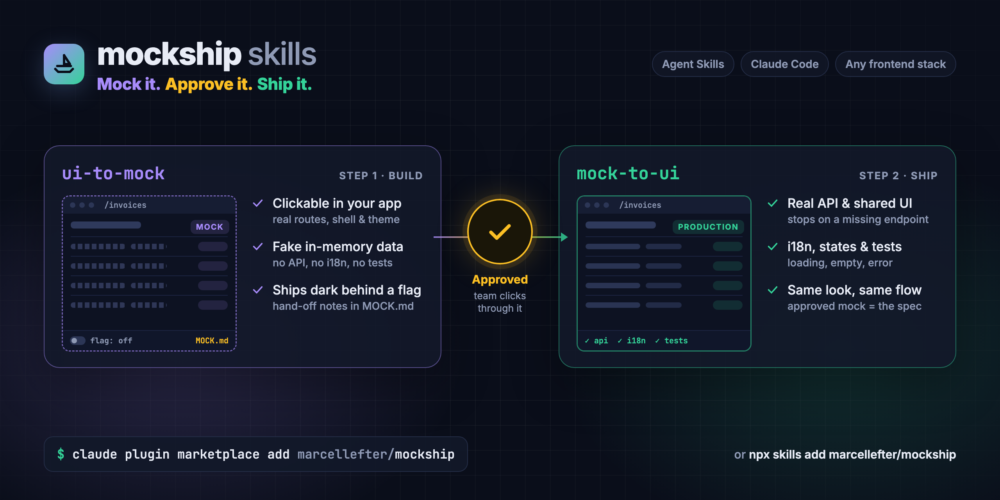

# mockship



**Mock it, approve it, ship it.** Two [Agent Skills](https://agentskills.io) that split UI work
into a fast, throwaway-feeling mock that lives in your real app, and a disciplined promotion of
that mock into production code once it is approved.

| Skill | What it does |
| --- | --- |
| [`ui-to-mock`](skills/ui-to-mock/SKILL.md) | Builds a clickable mock of a screen or flow inside your existing app — real routes, real layout, real theme, fake in-memory data — behind a feature flag that defaults off. No tests, no i18n, no API calls. Writes a `MOCK.md` hand-off. |
| [`mock-to-ui`](skills/mock-to-ui/SKILL.md) | Takes an approved mock (a feature folder with a `MOCK.md`) and turns it into production code: real API operations, shared components, translations, loading/empty/error states and tests — without changing what the user approved. |

They work with any frontend stack that has routes, a component library or theme, and ideally a
feature-flag system. The agent reads your project's own conventions (`AGENTS.md`, `CLAUDE.md`,
`CONTRIBUTING.md`, other installed skills) and follows them; the skills only add the rules that
make a mock a mock.

## Why

Clickable prototypes built in a separate tool drift from the real app, and prototypes built
straight in the app tend to grow into half-finished production code. mockship keeps the two
phases apart:

- **The mock is cheap and contained.** All code lives in one feature folder. Shared code is
  read-only; anything that nearly fits is copied locally and listed as a _stand-in_. The only
  edits outside the folder are the flag, the routes, and an entry point if you ask for one.
- **The mock ships dark.** A feature flag that defaults off gates every mock page, so a mock can
  be merged and demoed on any environment without users seeing it.
- **The mock is the spec.** `mock-to-ui` changes how the feature is built, never what a user
  sees. When a production constraint would change the UI, the agent stops and asks.
- **Gaps stop the line.** If the approved screens need an API operation that does not exist,
  `mock-to-ui` lists the gap and waits — it never hand-writes a request around your API layer.

## Install

### Claude Code (plugin marketplace)

```bash
claude plugin marketplace add marcellefter/mockship
```

```bash
claude plugin install mockship@mockship
```

Or, inside a session: `/plugin marketplace add marcellefter/mockship`, then `/plugin install
mockship@mockship`. The skills are then available as `/mockship:ui-to-mock` and
`/mockship:mock-to-ui`, and the agent also picks them up on its own when a request matches.

### Any agent that supports Agent Skills (skills CLI)

```bash
npx skills add marcellefter/mockship
```

### Manually

Copy the folders under [`skills/`](skills) into your agent's skills directory — for example
`.claude/skills/` in a project (or `~/.claude/skills/` for every project), or `.agents/skills/`
for agents that read that path:

```bash
git clone https://github.com/marcellefter/mockship.git
```

```bash
cp -r mockship/skills/ui-to-mock mockship/skills/mock-to-ui .claude/skills/
```

## Usage

### 1. Build the mock

Ask for it in plain words, or hand over a design file or screenshot:

> Mock an Invoices list and an invoice detail page so product can click through it before the
> backend exists.

The agent will:

1. **Discover the stack and take intake** — framework, router, design system, flags, data
   layer, i18n, tests, permissions; then the screens, the flow between them, the states each
   one needs and who sees what. Anything left open is asked before building.
2. **Add the flag first**, the same way your project declares other flags, defaulting to off.
   If your project has no flag mechanism, it offers a build-time env var, a development-only
   route or a development URL switch and lets you pick — it never invents one silently.
3. **Build the screens** in one feature folder: each page is a real route, tabs/modals/filters
   and form submits work, and writes change in-memory data seeded from a `mockData` module.
   Styling comes from your component library and theme tokens, and the layout matches the
   nearest similar page in the app.
4. **Make every state reviewable** — `?scenario=empty`, `?scenario=error`,
   `?scenario=loading` (and `?role=viewer` when access differs), so reviewers sign off on those
   too.
5. **Keep `MOCK.md` current** at the feature root: status, flag, stack, screens and flow, a
   review link per screen and state, access, touchpoints, local stand-ins, assumed data,
   decisions and open questions.
6. **Check its own work** — the project's type-check, plus two scripts: only the feature folder
   and the listed touchpoints changed, and no literal colours, sizes or raw palette classes
   (token idioms such as `hsl(var(--x))`, breakpoints and hairlines pass) — and report the
   review links.

Changing an approved mock puts it back to draft; abandoning one undoes every touchpoint it
listed; several mocks can be in flight at once. With a file-based router (Next.js, SvelteKit,
Nuxt, Remix) the route files stay thin and import from the feature folder.

### 2. Review and sign off

The agent asks how reviewers will reach the mock (a preview deployment with the flag on, flag
targeting for named accounts, or a walkthrough) and records it. Feedback goes into the mock and
the _Decisions_ log. Only you can mark it approved:

> Product signed off on the Invoices mock today — Ana Popescu.

### 3. Ship it

> The Invoices mock is approved — make it production-ready.

The agent works through ten steps, each with a clear finish line: confirm sign-off and
inventory the folder, screenshot every review link as a baseline, map every read and write to
a real API operation, map _Access_ onto your permission checks, resolve each stand-in against
shared components, restructure to your conventions, swap the in-memory data for your data
layer, move copy into i18n, write and run tests, then compare screenshots against the baseline
and hand off.

It keeps a _Promotion_ record in `MOCK.md`, so a later session resumes where this one stopped.
When an API operation or permission is missing it **stops** and gives you a drafted contract
for the API owner instead of hand-writing a request. `MOCK.md`, `mockData` and the review
parameters are deleted; the flag and gate stay so rollout remains the product owner's call.

## Repository layout

```
mockship/
├── .claude-plugin/marketplace.json   # Claude Code marketplace + plugin definition
├── skills/
│   ├── ui-to-mock/
│   │   ├── SKILL.md
│   │   ├── assets/MOCK.template.md
│   │   ├── references/               # stack discovery, flag options and gates per framework
│   │   ├── scripts/                  # check-boundary.sh, check-tokens.sh
│   │   └── evals/                    # test cases (claude plugin eval format)
│   └── mock-to-ui/
│       ├── SKILL.md
│       └── evals/
├── examples/
│   ├── sample-app/                   # React + Vite app the evals run against
│   ├── overlays/                     # layers on the sample app: no flags, a finished mock, draft status
│   ├── scaffold.sh                   # sets up the sample app for an eval run
│   ├── test-scripts.sh               # tests for the check scripts
│   └── test-fixtures.sh              # sets up every eval case and checks it
├── assets/                           # README image and its source
├── .github/workflows/ci.yml
├── CHANGELOG.md
└── LICENSE
```

Each skill follows the [Agent Skills specification](https://agentskills.io/specification): a
folder whose `SKILL.md` carries `name` and `description` frontmatter, with longer material in
`references/`, `assets/` and `scripts/` that the agent loads only when needed.

## Testing

CI validates the marketplace manifest and both skills against the spec, installs them with
`npx skills add`, tests the check scripts, builds and tests the sample app, and sets up every
eval case to prove it typechecks and that each mock in it passes the skill's own checks.

The behaviour of the skills themselves is covered by eval cases that run a real agent against
the sample app, with and without the skill. With Claude Code 2.1.269 or later, from a skill
folder:

```bash
npm ci --prefix examples/sample-app
```

```bash
cd skills/ui-to-mock && claude plugin eval . --scaffold --allow-tools Write,Edit,Bash --runs 1
```

These are real, billed model runs — each case scaffolds a fresh copy of the sample app and can
take several minutes.

Latest results (2026-10-27, Claude Opus 5.5, one run per case; ★ = last run on 1.1.x):

| Skill | Case | With skill | Without |
| --- | --- | --- | --- |
| ui-to-mock | builds-flagged-invoices-mock | 1.00 | 0.27 |
| ui-to-mock | keeps-draft-until-approver-named | 1.00 | 0.50 |
| ui-to-mock | offers-options-when-no-flag-system ★ | 1.00 | 0.25 |
| ui-to-mock | keeps-shared-badge-read-only ★ | 1.00 | 0.75 |
| ui-to-mock | ignores-test-double-requests | 1.00 | 1.00 |
| mock-to-ui | asks-for-sign-off-when-draft | 1.00 | 0.33 |
| mock-to-ui | stops-on-missing-api-operations ★ | 1.00 | 0.83 |
| mock-to-ui | promotes-approved-mock-end-to-end | 1.00 | not run |
| mock-to-ui | extends-shared-badge-for-stand-in | 1.00 | 1.00 |
| mock-to-ui | edits-draft-mock-without-promoting | 1.00 | 1.00 |

`ignores-test-double-requests` and `edits-draft-mock-without-promoting` are trigger guards:
they check that the skill stays out of the way, so a tie with the baseline is the expected
result. `extends-shared-badge-for-stand-in` still ties and guards against regressions. Graders
read the files a run leaves behind wherever they can, because a judge model only sees the first
and last twelve messages of a long run.

Both skills have also been run end to end on the sample app (2026-10-27) by fresh agents that
had only the skill to go on; the transcripts are not in this repository. `ui-to-mock` built a
flag-gated Invoices mock (list, detail, create modal, a new purple status, viewer vs admin) with
review links for every state, took one round of feedback and recorded the sign-off.
`mock-to-ui` confirmed the sign-off, screenshotted all 13 review states, and stopped on two
missing API operations (delete, the new status) and a missing typed not-found error, with a
drafted contract for each. Once the backend added them, it shipped the feature with 28 new
tests and screenshots matching the approved mock.

## Adapting

The skills deliberately defer to your project for anything stack-specific. If you want them
sharper for one codebase, fork and name the specifics: where feature folders live, the flag
helper to use, your design-system skill, your data-fetching library. Keep the core rules —
flag first, shared code read-only, `MOCK.md` hand-off, the mock is the spec, gaps stop the line.

## License

[MIT](LICENSE)
